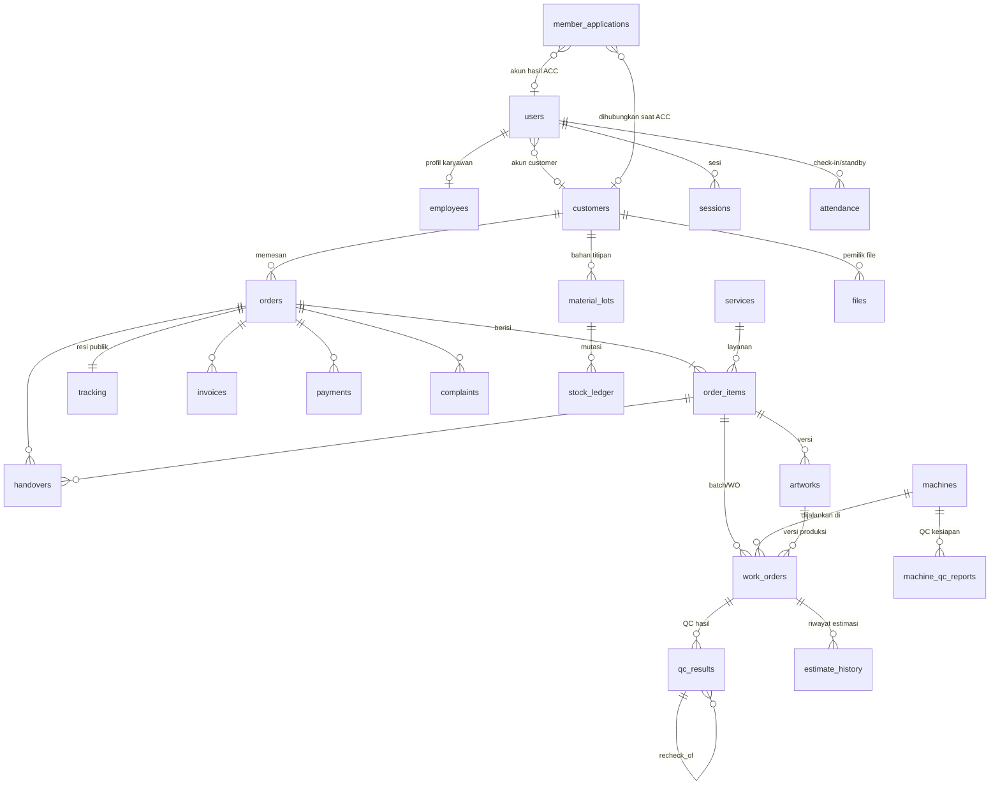

# ERD

Skema lengkap ada di `migrations/0001_init.sql`, `0003_files.sql`, `0004_qc_recheck.sql`. Diagram berikut memakai Mermaid (tampil otomatis di GitHub dan editor Markdown yang mendukungnya). Semua waktu disimpan sebagai epoch milidetik UTC; kode dan nomor disimpan sebagai TEXT.

## Jaminan di tingkat database

- `work_orders`: indeks unik parsial `idx_one_running_per_machine` (satu mesin hanya boleh punya satu WO `berjalan`).
- `stock_ledger`: unik `(source_type, source_id, kind)` sehingga mutasi per sumber idempotent.
- `artworks`: unik `(item_id, version)`; revisi menambah versi, tidak menimpa.
- `member_applications.consent_contact` wajib 1.
- `bootstrap`: satu baris, `used_at` diisi sekali.
- `users.role` dibatasi CHECK; pendaftar publik tidak pernah menulis ke tabel ini.
